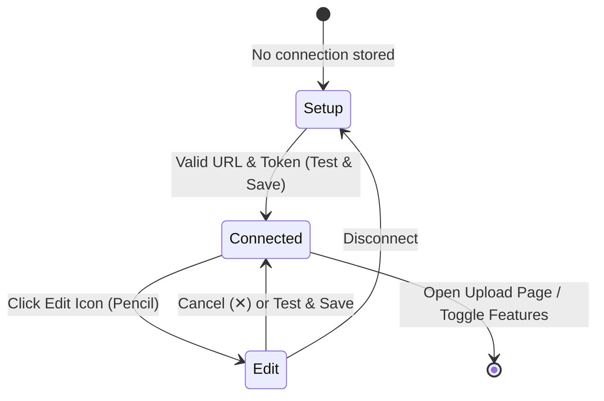

# Bookdock Browser Extension (书坞浏览器扩展)

The official browser extension for [Bookdock](https://github.com/BookdockDevs/bookdock), enabling one-click delivery of EPUB and TXT files from any webpage directly into your self-hosted Bookdock library.

> [!NOTE]
> The browser extension is distributed as standalone release packages and is not bundled with the self-hosted Docker/Web container images.

---

## Features

- **Anywhere Web Drag & Drop**: Drag EPUB or TXT files over any ordinary web page to reveal a centered drop card. Release inside to upload, or drag outside to cancel.
- **Isolated Closed Shadow DOM**: Drop target and overlays are rendered in a closed Shadow DOM, preventing CSS conflicts or interference with native page forms and file inputs.
- **Dedicated Upload Studio**: Clean, responsive full-page upload interface featuring real-time batch progress, chunked transfers, duplicate book detection, and retry controls.
- **Smart Tri-State Popup**:
  - **Setup View**: Streamlined first-time setup with instance URL and access token configuration.
  - **Launcher View**: Connected status badge, active instance details, quick toggles, and instant upload page access.
  - **Edit View**: Seamless connection updates with non-destructive connection testing ("Test connection" vs. "Test & Save") and one-click disconnect.
- **Seamless Reading Transition**: Once uploaded, single files automatically open directly in the Bookdock reader; batches navigate to the instance library.
- **Full Privacy & Security**: Operates exclusively between your browser and your configured Bookdock server. Zero telemetry, zero analytics, and zero external tracking.

---

## Architecture & Interface States

### 1. Popup Workflow (Tri-State Model)



- **Unconnected (Setup)**: Shown when no server is connected. Guides the user to create an access token with `ext:upload` permissions in Bookdock Web settings.
- **Connected (Launcher)**: Minimal launcher displaying the connected instance name, host URL, live health status indicator, shortcut to open the web app, and toggles for:
  - **Web drop upload (`网页拖拽投送`)**: Enable or disable page-level drag-and-drop interception.
  - **Open Bookdock after upload (`完成后打开书坞`)**: Toggle automatic opening of the reader/library upon upload completion.
- **Edit Connection**: Unfolds instance URL and token inputs (with password reveal toggle).
  - If inputs are **unchanged**, the button acts as **Test connection (`测试连接`)**, validating server connectivity inline without closing the panel.
  - If inputs are **modified**, the button acts as **Test & save (`测试并保存`)**, validating credentials, persisting them, and collapsing back to the launcher.
  - Includes a secondary **Disconnect (`断开当前连接`)** action to clear credentials and reset extension state.

### 2. Standalone Upload Tab (`upload.html`)

The upload interface runs in its own tab rather than an ephemeral popup or modal dialog:
- Built with React and Tailwind CSS matching Bookdock's design system.
- Provides multi-file drop queues, individual transfer progress, batch retry, and duplicate warning resolution.
- Equipped with `beforeunload` drop protection to guard active uploads against accidental tab closure.

---

## Setup & Connecting

1. Open your Bookdock Web instance.
2. Go to **Settings (`设置`)** → **Access Tokens (`访问令牌`)** and generate a new token with the **Upload books (`ext:upload`)** permission.
3. Click the Bookdock extension icon in your browser toolbar.
4. Enter your instance base URL (e.g. `https://books.example.com` or local `http://192.168.1.100:18423`) and paste the access token.
5. Click **Test and save**.

> [!TIP]
> Use HTTPS for public instances. HTTP is fully supported for local/private home lab networks.

---

## Installing from GitHub Releases

Download the pre-built extension archive from [GitHub Releases](https://github.com/BookdockDevs/bookdock/releases):

- **Chrome / Edge / Brave** (`bookdock-extension-chrome-<version>.zip`):
  1. Extract the `.zip` archive to a folder on your computer.
  2. Open `chrome://extensions` (or `edge://extensions`) and enable **Developer mode**.
  3. Click **Load unpacked** and select the extracted folder (the directory containing `manifest.json`).
  4. When updating later, extract the new release into that folder and click **Reload** on the extension card.

- **Firefox** (`bookdock-extension-firefox-<version>.zip`):
  - Standard release builds of Firefox require Mozilla add-on signatures for permanent installation.
  - Extract the `.zip` archive, open `about:debugging#/runtime/this-firefox`, click **Load Temporary Add-on...**, and select `manifest.json` inside the extracted folder (remains active until Firefox restarts; Developer Edition, Nightly, or ESR builds allow unsigned installation when signature checks are disabled).

---

## Development & Building

### Prerequisites

From the monorepo root:

```bash
pnpm install --frozen-lockfile
```

### Build Commands

| Command | Description |
|---------|-------------|
| `pnpm --filter @bookdock/extension build` | Fast build of unpacked extensions (`dist/chrome` and `dist/firefox`) |
| `pnpm --filter @bookdock/extension typecheck` | Run TypeScript type checks |
| `pnpm --filter @bookdock/extension test` | Run extension unit and i18n test suites with Vitest |
| `pnpm build:extension` | Pack extension store zips and reproducible source zip |

### Output Artifacts

Artifacts are compiled into `apps/extension/dist/`:

- `chrome/`: Unpacked Chrome MV3 extension (compatible with Chrome 120+, Edge, Brave, Opera).
- `firefox/`: Unpacked Firefox MV3 candidate (compatible with Firefox 140+).
- `bookdock-extension-{chrome,firefox}-{version}.zip`: Production store submission packages.
- `bookdock-extension-source-{version}.zip`: Reproducible source bundle for extension store reviewers.

### Loading Unpacked Extensions

#### Chrome / Edge
1. Navigate to `chrome://extensions` (or `edge://extensions`).
2. Enable **Developer mode** in the top right.
3. Click **Load unpacked** and select `apps/extension/dist/chrome`.
4. After making changes and rebuilding, click the **Reload** icon on the extension card.

#### Firefox
1. Navigate to `about:debugging#/runtime/this-firefox`.
2. Click **Load Temporary Add-on...**.
3. Select `apps/extension/dist/firefox/manifest.json`.
4. *Note: Persistent installation in Firefox requires Mozilla add-on signing.*

---

## Internationalization (i18n)

The extension UI adapts automatically to the browser language:
- **Chinese (`zh*`)**: Defaults to Simplified Chinese (`zh-CN`).
- **English**: Fallback for all other locales.

### Structure
- **Static Markup**: Elements declare `data-i18n`, `data-i18n-placeholder`, or `data-i18n-title` attributes, translated dynamically at load time via `localizeDocument()`.
- **Runtime Strings**: Translated via `t(key, params)` from `src/i18n`.
- **Locale Tables**: Located in `src/i18n/messages.zh-CN.ts` and `src/i18n/messages.en.ts`. Type safety ensures both tables share identical keys and placeholders.
- **Store & Manifest Metadata**: Localized strings are compiled into `_locales/{zh_CN,en}/messages.json` by `build.mjs`.

---

## Verification & Testing

### Automated Browser E2E Probe

An automated end-to-end smoke test verifies drag-and-drop behavior, content-script injection, and popup rendering in a disposable browser profile:

```bash
node scripts/verify-extension-drop.mjs
```

- Custom browser executable: set `BOOKDOCK_PROBE_BROWSER=/path/to/chromium`.
- Container / sandbox environments: set `BOOKDOCK_PROBE_NO_SANDBOX=1`.
- Outputs visual verification screenshots to `.tmp/extension-probe/` (e.g. `popup.png`, `extension-drop-hover.png`).

---

## Permissions & Security

The extension requests only minimal permissions necessary for core operation:

- `scripting`: Activates drop listeners on existing open tabs immediately upon connection without requiring manual page refreshes.
- `alarms`: Automatically purges expired temporary chunks and abandoned upload tasks.
- `http://*/*` and `https://*/*` (`host_permissions`): Enables drag detection on arbitrary HTTP/HTTPS sites and uploads to user-configured self-hosted instances.

Connection settings, preferences, and temporary upload chunks are stored locally in the extension's IndexedDB (`bookdock-extension`), so no `storage` permission is required.

**What the extension does NOT do**:
- No browser history, tabs, or browsing activity collection.
- No cookies or session reading.
- No webpage text or content extraction.
- No third-party network requests, ads, or analytics.
